<p align="center">
  
</p>

<h1 align="center">VansonCraft</h1>

<p align="center">
  <b>Vector illustration: an open-source, modern vector art application, built in pure Rust.</b>
</p>

<p align="center">
  A fast, open-source vector illustration workflow. It runs natively on macOS, Windows, Linux and
  FreeBSD, and in the browser via WebAssembly, and agents such as Claude and Codex can draw with it
  over MCP.
</p>

<p align="center">
  
  
  
  
  
</p>

<p align="center">
  <a href="https://github.com/vansyson1308/vansoncraft"><b>Source</b></a> ·
  <a href="https://github.com/vansyson1308/vansoncraft/issues">Issues</a> ·
  <a href="docs/speed/README.md">Drawing with agents</a> ·
  <a href="ROADMAP.md">Roadmap</a>
</p>

<br>

<p align="center">
  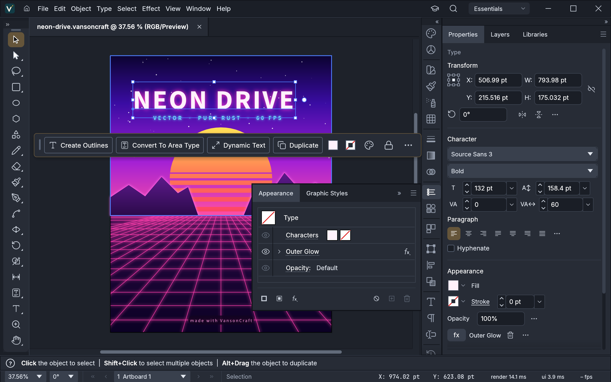
  <br><sub><b>Neon Drive</b>: a Pathfinder-cut sun, live Outer Glow on the type and grid, and clipping masks · <code>examples/neon-drive.vansoncraft</code></sub>
</p>

<p align="center">
  <a href="#a-look-around">A look around</a> ·
  <a href="#made-in-vansoncraft">Made in VansonCraft</a> ·
  <a href="#drawing-with-agents-after-harold-speed">Drawing with agents</a> ·
  <a href="#why-vansoncraft">Why VansonCraft</a> ·
  <a href="#quick-start">Quick start</a> ·
  <a href="#status">Status</a> ·
  <a href="#downloads">Downloads</a> ·
  <a href="#license-and-credits">License</a>
</p>

## A look around

<table>
<tr>
<td width="50%" valign="top">
  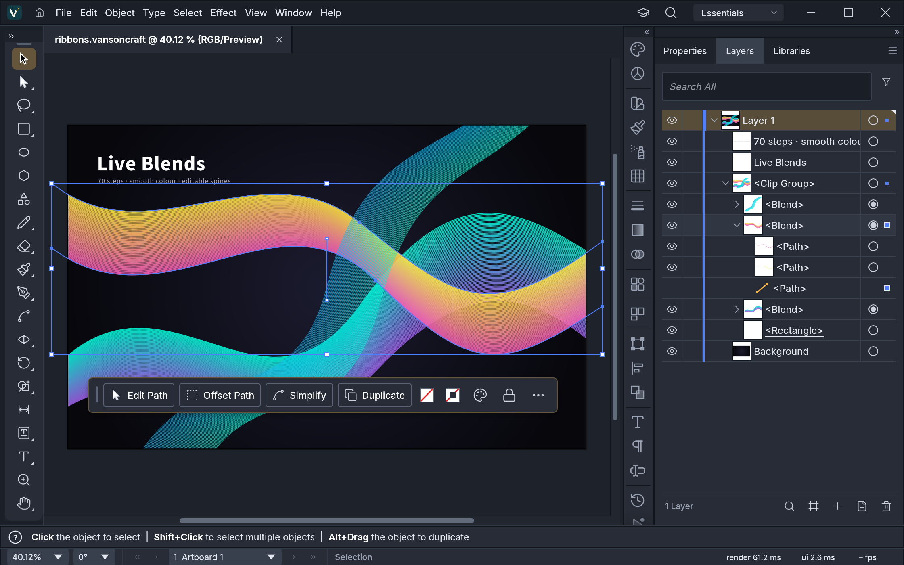
  <p align="center"><sub><b>Live Blends and Layers</b>: editable key paths, smooth colour, every object a row</sub></p>
</td>
<td width="50%" valign="top">
  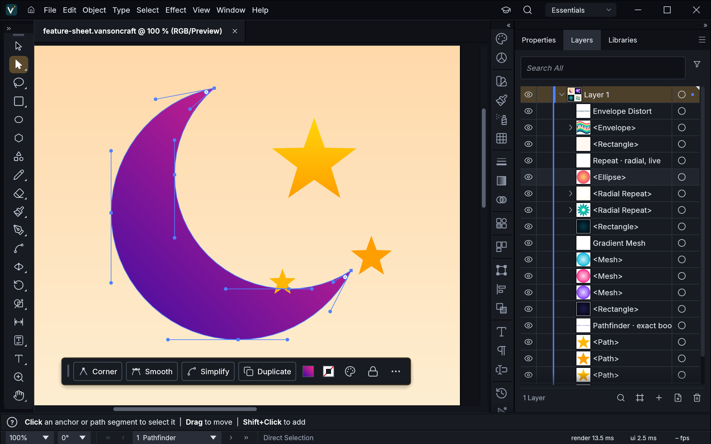
  <p align="center"><sub><b>Pen and Direct Selection</b>: real Bézier anchors and handles, plus a contextual task bar</sub></p>
</td>
</tr>
<tr>
<td width="50%" valign="top">
  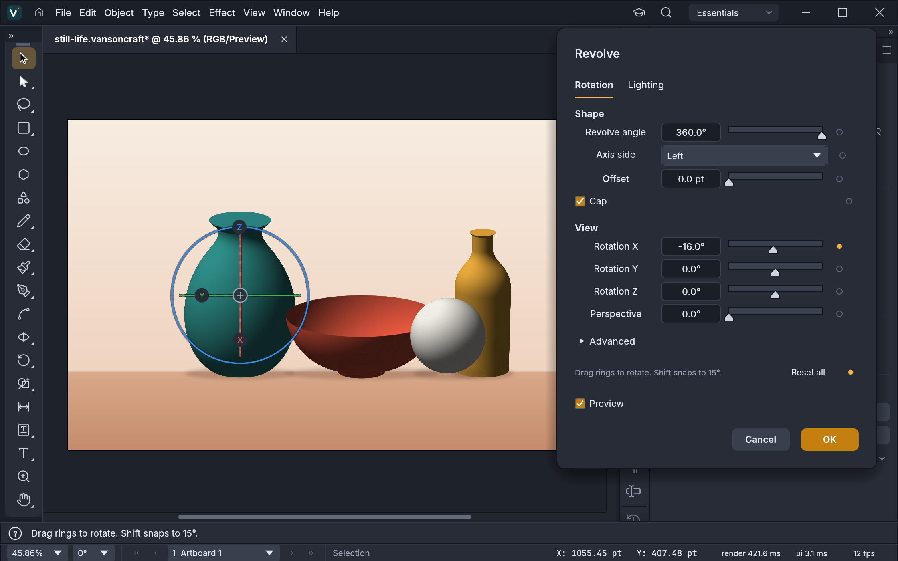
  <p align="center"><sub><b>3D Revolve</b>: smooth vector shading, caps and a rotation gizmo · <code>examples/still-life.vansoncraft</code></sub></p>
</td>
<td width="50%" valign="top">
  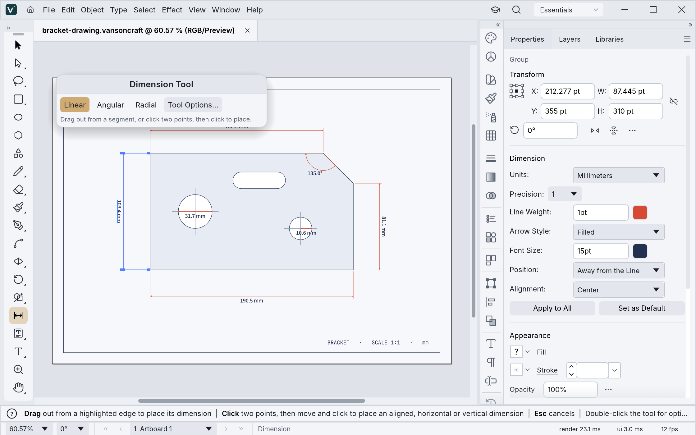
  <p align="center"><sub><b>Dimension tool</b>: lengths, angles and radii that follow the art they measure · <code>examples/bracket-drawing.vansoncraft</code></sub></p>
</td>
</tr>
<tr>
<td width="50%" valign="top">
  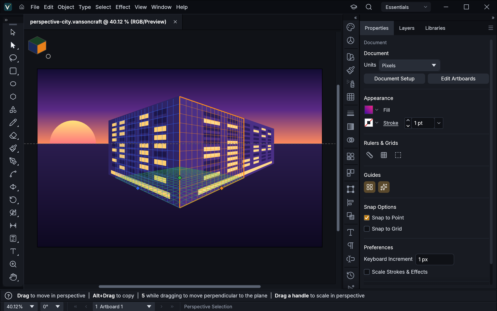
  <p align="center"><sub><b>Perspective Grid</b>: art attached to its planes stays editable in perspective · <code>examples/perspective-city.vansoncraft</code></sub></p>
</td>
<td width="50%" valign="top">
  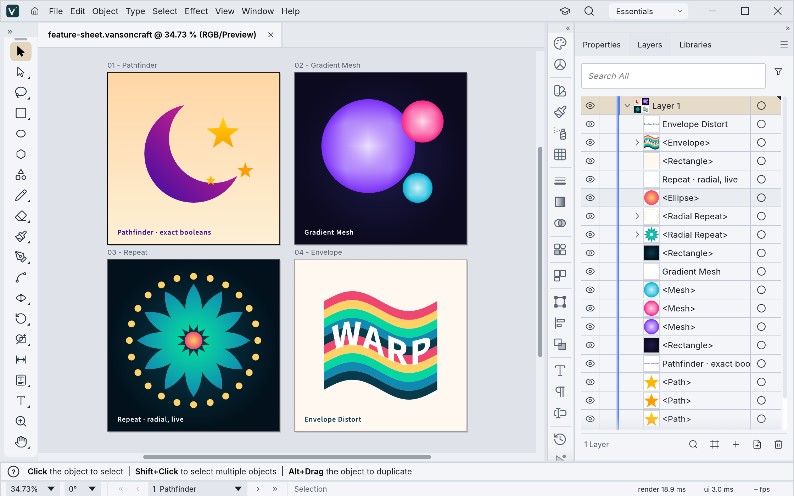
  <p align="center"><sub><b>Multiple artboards, light theme</b>: Pathfinder · Gradient Mesh · live radial Repeat · Envelope Distort · <code>examples/feature-sheet.vansoncraft</code></sub></p>
</td>
</tr>
</table>

## Made in VansonCraft

Every piece below was built entirely through VansonCraft's command API, the same one the MCP server
exposes to agents, and exported by VansonCraft's own renderer. The source files are in
[`examples/`](examples).

<table>
<tr>
<td width="50%" valign="top">
  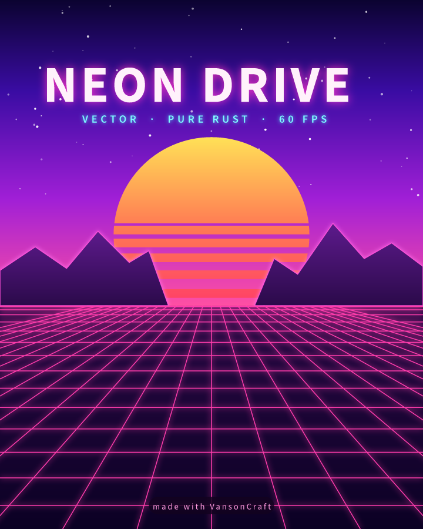
  <p align="center"><sub><b>Neon Drive</b>: synthwave poster with glowing type and grid</sub></p>
</td>
<td width="50%" valign="top">
  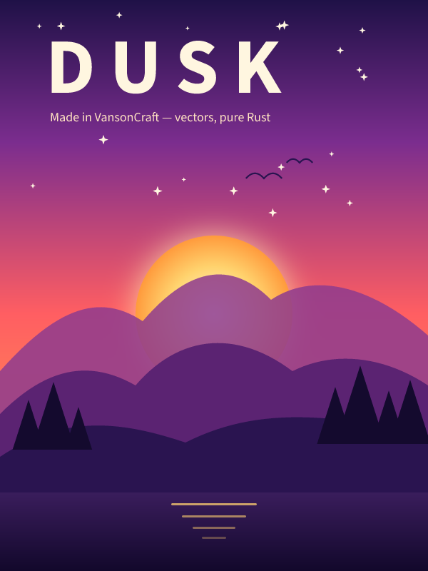
  <p align="center"><sub><b>Dusk</b>: gradient sky, glowing sun, layered mountains</sub></p>
</td>
</tr>
<tr>
<td colspan="2" valign="top">
  
  <p align="center"><sub><b>Live Blends</b>: 70 steps, smooth colour, editable spines</sub></p>
</td>
</tr>
<tr>
<td colspan="2" valign="top">
  
  <p align="center"><sub><b>Still Life</b>: four revolved profiles with smooth vector shading</sub></p>
</td>
</tr>
<tr>
<td width="50%" valign="top">
  
  <p align="center"><sub><b>Radial Repeat</b>: a live mandala</sub></p>
</td>
<td width="50%" valign="top">
  
  <p align="center"><sub><b>Envelope Distort</b>: striped type warped into a flag</sub></p>
</td>
</tr>
<tr>
<td width="50%" valign="top">
  
  <p align="center"><sub><b>Gradient Mesh</b>: shaded spheres</sub></p>
</td>
<td width="50%" valign="top">
  
  <p align="center"><sub><b>Pathfinder</b>: a crescent and stars from exact booleans</sub></p>
</td>
</tr>
</table>

## Drawing with agents, after Harold Speed

VansonCraft adds a drawing method for agents, grounded in a full reading of Harold Speed's *The
Practice and Science of Drawing* (1913): study commands that measure what was drawn
(`study.values`, `study.balance`, `study.lines`, `study.proportions`, `study.compare`), previews of
any region in colour, grey or value groups (`study.render`, MCP `render_preview`), construction
lines and clipped hatching drawn as editable art (`study.blockIn`, `study.hatch`), the method notes
as MCP resources and four workflows as MCP prompts. The reading ledgers, the traceability from each
principle to the app, the acceptance results and the client set-up are in
[`docs/speed/`](docs/speed/README.md); the example drawings in [`examples/speed/`](examples/speed/README.md).

<table>
<tr>
<td width="33%" valign="top">
  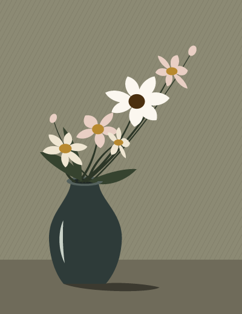
  <p align="center"><sub><b>Composition A</b>: a diagonal rise in three value groups</sub></p>
</td>
<td width="33%" valign="top">
  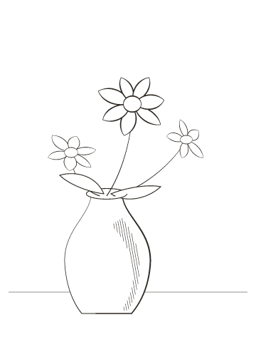
  <p align="center"><sub><b>Line study</b>: weight hierarchy and hatching down the form</sub></p>
</td>
<td width="33%" valign="top">
  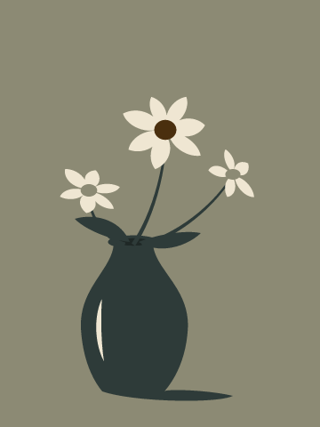
  <p align="center"><sub><b>Mass study</b>: three tones, fills only</sub></p>
</td>
</tr>
</table>

## Why VansonCraft

- **Familiar.** A familiar layout, tools, menus, panels and shortcuts: the Pen, Direct Selection,
  Pathfinder, Smart Guides, Appearance, Swatches, Layers and more. You already know how to use it.
- **Fast.** Multithreaded SIMD rendering off the UI thread. 20,000 shapes render in about 27 ms at
  full retina resolution while the interface stays at 120 fps.
- **Robust.** Exact curve booleans (no "cannot perform operation"), unlimited undo via structural
  sharing, and property-tested file round trips.
- **Open.** A documented native format (`.vansoncraft`, JSON), first-class SVG, PDF (and
  PDF-compatible `.ai`) import and export, PNG/JPEG/WebP export, Export for Screens, and SVGZ,
  templates, GIF, TIFF and BMP on open.
- **Agent-native.** Every menu item, tool gesture, panel and dialog can be driven over a JSON
  control channel and an **MCP server**, so Claude and other agents can draw, edit and export the
  way a person does.
- **Everywhere.** One codebase for the desktop apps and the same UI in the browser.

## Quick start

For posters and sewing patterns, see [Print a large poster across multiple pages](docs/print-tiling.md).

```sh
git clone https://github.com/vansyson1308/vansoncraft
cd vansoncraft

cargo run --release -p vansoncraft                          # desktop app
cargo run --release -p vansoncraft -- examples/dusk-poster.vansoncraft
cargo run --release -p vansoncraft -- --control 7979        # + JSON control channel
cargo run --release -p vansoncraft-cli -- mcp               # MCP server (stdio)
cargo run --release -p vansoncraft-cli -- run --in examples/ribbons.vansoncraft --export out.pdf   # headless batch
cargo run --release -p vansoncraft-cli -- bench examples/neon-drive.vansoncraft                   # render timing
cargo xtask bundle                                        # dist/VansonCraft.app (macOS)
cd apps/vansoncraft-web && trunk build --release            # web build → dist/web
cargo xtask ci                                            # fmt, clippy, tests, layering, wasm, vendor names
```

For text and custom letter shapes, see [Typography and Custom Lettering](docs/typography-lettering.md).

Japanese fonts can come from the separate font collection [craft-fonts](https://github.com/storytold/craft-fonts),
an optional build input: `CRAFT_FONTS_DIR="$PWD/../craft-fonts" cargo run --release -p vansoncraft` (an absolute path).
Without it, Japanese text uses the installed system fonts. See [`docs/development.md`](docs/development.md#fonts-craft-fonts-optional-build-input).

On machines with two graphics processors, VansonCraft renders on the power-saving (integrated) one by default on
Windows and macOS, and on the one the desktop runs on under Linux. To choose, use **Preferences › Performance ›
Graphics Processor** and restart. If a graphics processor can't show the window, VansonCraft starts again on the
next one. To pick one when starting the app, set `WGPU_POWER_PREF=high` (or `low`), or `WGPU_ADAPTER_NAME` to part of
its name, such as `WGPU_ADAPTER_NAME=nvidia` (see [`docs/development.md`](docs/development.md#desktop-graphics-processor)).

On native Wayland, winit 0.30 does not deliver dropped files. To open an SVG, use File › Open;
to place artwork in the current document, copy and paste the file in a file manager. For file
drag-and-drop, set **Preferences › Performance › Linux Display Server** to **X11 (XWayland)** and restart, or start
the app with `WAYLAND_DISPLAY= vansoncraft`: the window then opens through XWayland, where drops work
(see [`docs/development.md`](docs/development.md#linux-wayland-and-x11)).

On Linux with Wayland, under KDE Plasma 6.3 or later and under GNOME, VansonCraft can't get a drawing tablet's pen
input on native Wayland yet (#491, #2028). When a pen is attached as VansonCraft starts, the window opens through
XWayland, where the pen works as a mouse and the app reads its pressure (#4967; `VANSONCRAFT_NATIVE_WAYLAND=1` keeps
Wayland). For a pen attached later, set the same preference to **X11 (XWayland)** and restart, or start the app with
`WAYLAND_DISPLAY= vansoncraft` (see [`docs/development.md`](docs/development.md#linux-wayland-and-x11)).

### Use it from Claude Code and other agents

Register the MCP server with Claude Code:

```sh
claude mcp add vansoncraft -- /path/to/vansoncraft-cli mcp
```

To keep an agent to one project's files, give it folders to read and write:

```sh
claude mcp add vansoncraft -- /path/to/vansoncraft-cli mcp --automation-read-root /work/project --automation-write-root /work/project
```

The details are in [`docs/mcp.md`](docs/mcp.md) and [`docs/control-protocol.md`](docs/control-protocol.md); Windows set-up,
Claude Desktop and Codex configuration and prompts in Vietnamese are in [`docs/speed/mcp-clients.md`](docs/speed/mcp-clients.md).

## Status

VansonCraft is under active development. [**ROADMAP.md**](ROADMAP.md) has the stage, the numbers by dimension
and what's next; [`docs/target-app-parity.md`](docs/target-app-parity.md) the full parity assessment and
[`docs/gaps.md`](docs/gaps.md) the ranked list of what's missing.

**Where we are (2026-10-10, unchanged at the fork): alpha.** About 88% of core menu items, tools, effects and formats exist
(92.5% of menu items do something), feature depth is ~75%, and we estimate ~65% ready for real work for a mainstream illustrator (~62% across all tracked features): everyday
vector illustration is close to usable: drawing and path tools,
Pathfinder and Shape Builder, paint, gradients, appearance and transparency, type with styles, threading and Hebrew/Arabic bidirectional layout, and
files (SVG, PDF and PDF-compatible `.ai` with PDF/X, legacy version 7 `.ai` keeping layers, groups and type, EPS, DXF, EMF/WMF, raster formats, PSD out, PSD/PSB opened with their layers and placed as their merged image, JPEG XL in, Print, Package).
Affinity documents (`.af` from Affinity 3, `.afdesign`, `.afpub` and, by their content, `.afphoto` from Affinity 1 and 2) open
and place natively: layers, groups, artboards and pages, curves and shapes, fills, gradients and strokes, clipping
and masks, text with each paragraph's indents, spacing and leading, tables (as text frames and lines), master
pages, shadows, glows, outlines and overlays, embedded Affinity documents and images, with what didn't come in
(adjustments, blurs, bevels, brushes…) listed in the import warning; a file whose native data can't be read opens as its embedded preview, saying why. VansonCraft
doesn't write Affinity files. Current `.af` validation includes 33 pinned files, native save/reload
and every-board SVG/PDF/PSD export, with fixes for Affinity 3 artboards, source-backed JPEGs and text runs.
[Scope and limits](crates/affinity/README.md); [source audit and remaining gaps](docs/affinity-validation.md).
The interface
speaks English, German, Japanese, Korean, Vietnamese, Traditional and Simplified Chinese, Spanish, French, Hungarian, Italian, Polish, Brazilian Portuguese, Russian, Swedish, Ukrainian, Finnish, Bulgarian, Greek, Czech, Georgian and Catalan;
[localization-parity.md](docs/localization-parity.md) has the details.
The scores are self-assessed from our code against public documentation;
[target-app-parity.md](docs/target-app-parity.md#how-this-was-measured-2026-10-10) explains how far to trust them.

**What's missing:**
- reliable exchange of .ai files (layer structure in real files; the editing copy a save writes keeps live effects only on paths, compound paths and groups that qualify (at most a fill and a stroke, a non-zero fill rule when filled, no large canvas) and whose appearance and effects the art-style writer supports (see [docs/file-format-parity.md](docs/file-format-parity.md)), leaves out other objects' effects other than geometry effects, and writes live objects as their art);
- an interaction-fidelity pass covering every tool's modifiers and small behaviours;
- 3D and Materials beyond the initial live Revolve (Extrude & Bevel, Inflate, Rotate, materials);
- filter thumbnails and a preview area inside the Effect Gallery (the gallery itself and all 57 Photoshop-style raster filters, approximated, are in);
- CJK composition for vertical type (vertical type itself has initial support, with a Japanese interface);
- scripting, and the rest of Variables (image and graph kinds, dataset import);
- generative AI features.

**Where we're going:** next is the interaction-fidelity pass, `.ai` files from real users and start-up stability,
alongside the raster-effects package; then type, recent additions and 3D. The ranked list is in
[`docs/gaps.md`](docs/gaps.md).

**Workspace:** `crates/{geom, color, doc, pathops, text, effects, three-d, trace, brush, render, svg, pdf, eps, cad, metafile, format, tools, engine, ui-egui, mcp, testkit}`
and `apps/{vansoncraft, vansoncraft-cli, vansoncraft-web}`. The egui frontend is its own crate, so
the UI can be swapped without touching the engine.

Agent and contributor rules (clean-room, the asset policy, no panics in shipped code, quality gates) are in
[`AGENTS.md`](AGENTS.md); [`docs/development.md`](docs/development.md#robustness-vansoncraft-never-crashes)
explains how VansonCraft avoids crashing, and [`docs/releasing.md`](docs/releasing.md) how releases are built
and what the first one needs. Every bundled asset is listed with its licence in [`ASSETS.md`](ASSETS.md).

## Downloads

There are no prebuilt releases of VansonCraft yet: build it from source (above). The packaging
scripts in [`packaging/`](packaging) build an MSI installer and a portable zip for Windows, a DMG for
macOS, AppImage, Flatpak, deb, rpm and a tarball for Linux, a FreeBSD tarball and the web build;
[`docs/releasing.md`](docs/releasing.md) describes them and what the first release needs. Releases,
once published, will be on [GitHub Releases](https://github.com/vansyson1308/vansoncraft/releases),
the only place the in-app updater looks.

## License and credits

VansonCraft is dual-licensed under [MIT](LICENSE-MIT) or [Apache-2.0](LICENSE-APACHE), at your option.
Copyright (c) 2026 vansyson1308.

VansonCraft is based on VectorCraft by the ArtCraft team, forked at version 0.24.1 in November 2026
and developed independently since; VectorCraft's copyright notice stays in [`LICENSE-MIT`](LICENSE-MIT)
and [`NOTICE`](NOTICE), as its licences require. The ArtCraft team does not make, sponsor or endorse
VansonCraft, and VansonCraft carries none of their trademarks.

Bundled fonts, icons, images and other assets keep their own open licenses; each one is listed
with its author, source and license in [ASSETS.md](ASSETS.md). Builds made with the optional
[craft-fonts](https://github.com/storytold/craft-fonts/blob/main/ATTRIBUTION.md) input also embed its
fonts (SIL Open Font License 1.1).

The app icon (a V drawn as a path, with one Bézier handle, on deep teal `#123c46`) is original
artwork made for VansonCraft; its palette and files are in [`assets/app-icon/`](assets/app-icon/README.md).

Maintained by [@vansyson1308](https://github.com/vansyson1308). Issues and suggestions are welcome on
[GitHub](https://github.com/vansyson1308/vansoncraft/issues).
